<p align="center">
  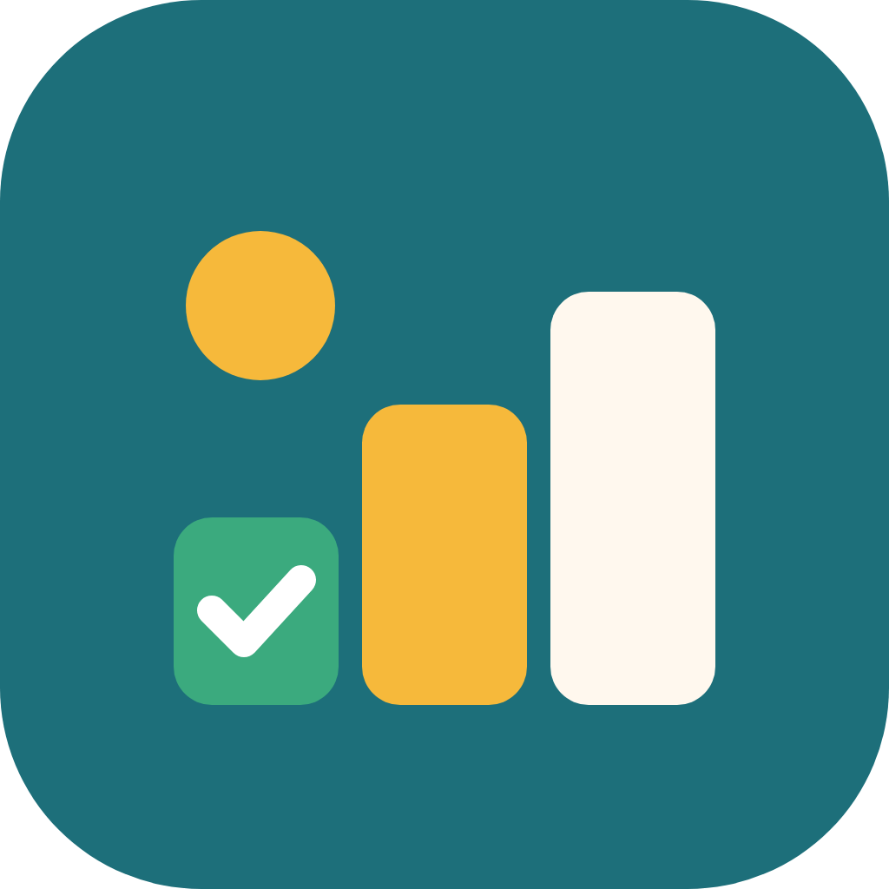
</p>

<h1 align="center">Daysteps</h1>

<p align="center">
  <b>Picture schedules, first–then boards and visual timers for autistic children.</b><br>
  Free and open source. Works offline. No account, no ads. Android and web.
</p>

<p align="center">
  <a href="https://github.com/lobojoel2003/Daysteps/actions/workflows/ci.yml"></a>
  <a href="https://github.com/lobojoel2003/Daysteps/releases/latest"></a>
  
  
  <a href="LICENSE"></a>
</p>

<p align="center">
  <a href="https://lobojoel2003.github.io/Daysteps/"><b>Open the web app</b></a> ·
  <a href="https://github.com/lobojoel2003/Daysteps/releases/latest"><b>Download for Android</b></a> ·
  <a href="#quick-start">Quick start</a> ·
  <a href="CHANGELOG.md">What's new</a>
</p>

<p align="center">
  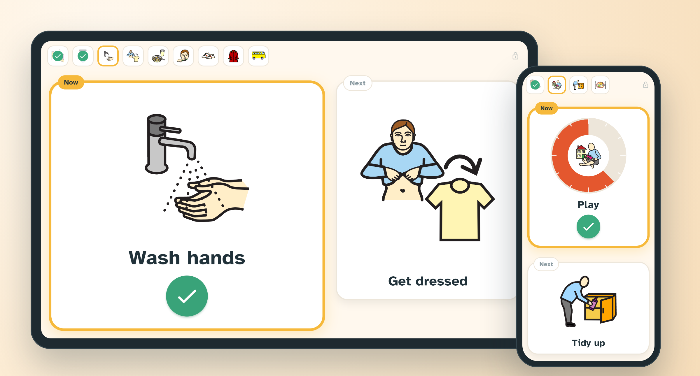
</p>

Many autistic children cope far better when the day is shown as pictures:
**what is happening now, and what comes next.** Parents and teachers print and
laminate cards, or pay for an iPad app. Daysteps does the same job on the
inexpensive Android tablet a family already has, or in any web browser.

An adult builds the schedule; **the child's device just shows it.**

## Contents

- [Why Daysteps](#why-daysteps)
- [Features](#features)
- [Get Daysteps](#get-daysteps)
- [Quick start](#quick-start)
- [Pictures and licences](#pictures-and-licences)
- [Privacy](#privacy)
- [Build from source](#build-from-source)
- [Releases and versioning](#releases-and-versioning)
- [CI/CD](#cicd)
- [Contributing](#contributing)
- [License](#license)

## Why Daysteps

**Visual schedules work.** The National Autism Center's National Standards
Project (Phase 2, 2015) rates schedules an **established intervention** for
autistic children, one that increases independence and the ability to plan for
events ([Association for Science in Autism Treatment][asat]). A review of the
single-case research by Knight, Sartini and Spriggs concluded that visual
activity schedules can be considered an evidence-based practice ([J Autism Dev
Disord, 2015][knight]).

**Many children need them.** The CDC's Autism and Developmental Disabilities
Monitoring Network found that **1 in 31** (32.2 per 1,000) children aged
8 years had been identified with autism in 2022 ([Shaw et al., MMWR Surveill
Summ 2025;74(No. SS-2)][cdc]).

**The good apps are closed, paid and mostly iPhone/iPad-only.**

| App | Platforms | Source code |
|---|---|---|
| [Choiceworks][choiceworks] (paid) | iPhone / iPad | closed |
| [PictoPlan][pictoplan] | iPhone / iPad | closed |
| [Pictalk Buddy][pictalk] | iPhone / iPad | closed |
| **Daysteps** (free) | **Android 7+ and any modern browser** | **open (GPL-3.0)** |

Families with a cheap Android tablet are left out, and the open-source options
we found were early prototypes. Daysteps is meant to be finished, calm and
dependable.

## Features

### For the child: almost nothing on the screen

<table>
  <tr>
    <td width="66%">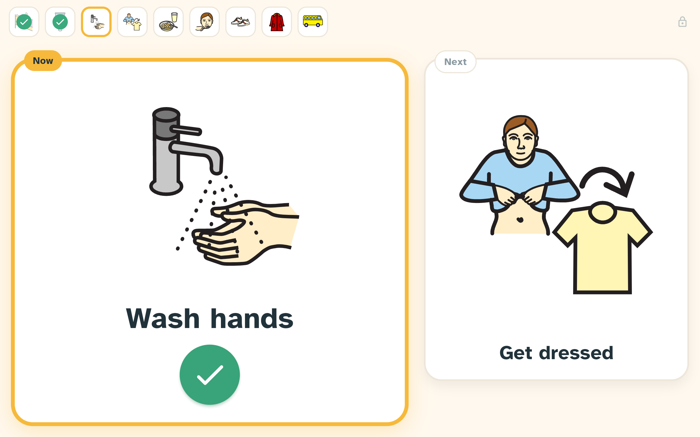</td>
    <td width="34%">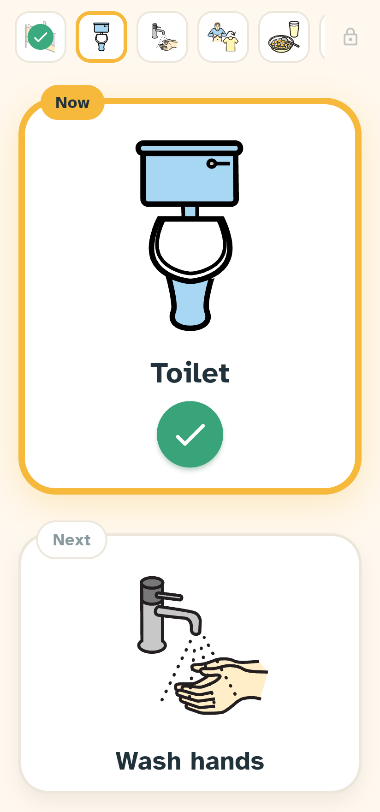</td>
  </tr>
</table>

- **Now and next.** The current step is large and ringed in yellow; the next
  step sits beside it. A row of small pictures shows the whole day, finished
  steps ticked.
- **One big green Done button**, and a satisfying "done" moment: a tick pops in
  with a burst of confetti, then the next step slides into place. Finishing
  the last step brings an **All done!** star.
- **Tap a picture to hear it**, read by the device's own voice.
- **No menus, no ads, no way to get lost.** The back button does nothing, the
  screen stays awake, and Android hides the system bars. Grown-ups get out by
  **holding the lock in the corner for two seconds and answering a sum**.
- **Calm motion** setting (and the system's reduce-motion option) replace the
  bouncy animations with gentle fades.

<table>
  <tr>
    <td width="50%">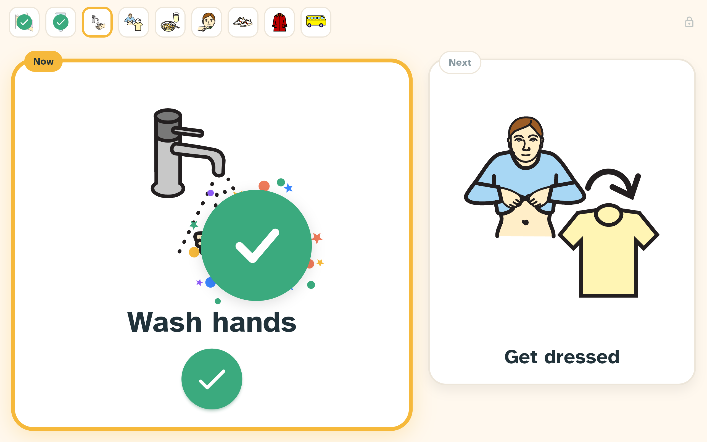</td>
    <td width="50%">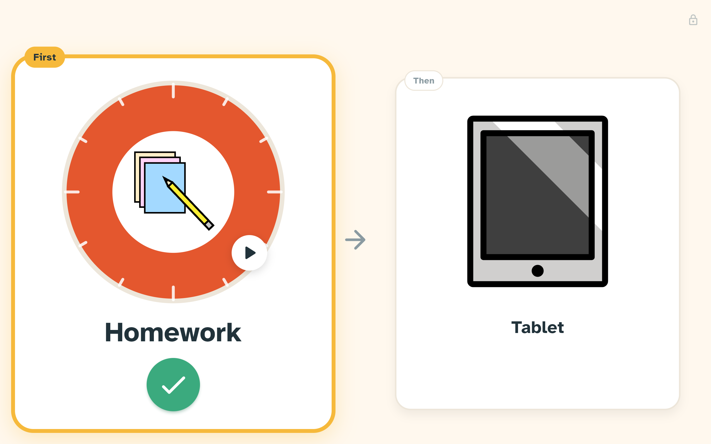</td>
  </tr>
  <tr>
    <td align="center"><b>The “done” moment</b></td>
    <td align="center"><b>First–then board</b></td>
  </tr>
</table>

### Visual timers that shrink as a coloured disc

<table>
  <tr>
    <td width="66%">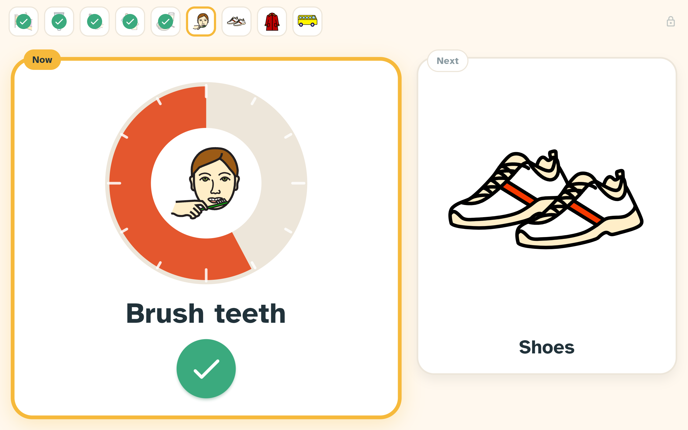</td>
    <td width="34%">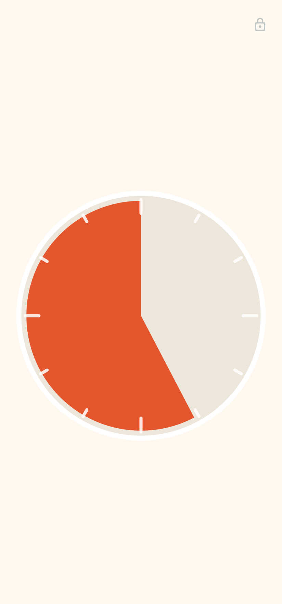</td>
  </tr>
</table>

- Give any step a timer (*brush teeth for 2 minutes*): the picture sits in the
  middle of a coloured disc that disappears as time passes. Tap to start or
  pause.
- Or start a **quick full-screen timer** from the home screen, with an
  optional picture of what it's for.
- Choose a **sweeping disc** (like a clock hand) or a **shrinking disc**, and
  one of six calm colours. No numbers unless you want them.
- When time is up the disc turns green, Daysteps says “Time is up” (and the
  device vibrates), and the Done button gently pulses.

### For the adult: a drag-and-drop editor

<table>
  <tr>
    <td width="66%">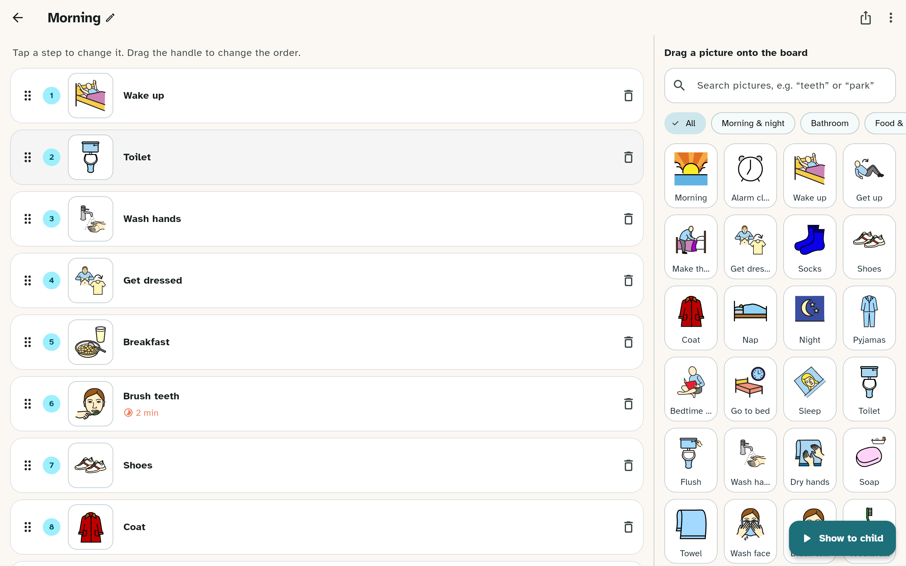</td>
    <td width="34%">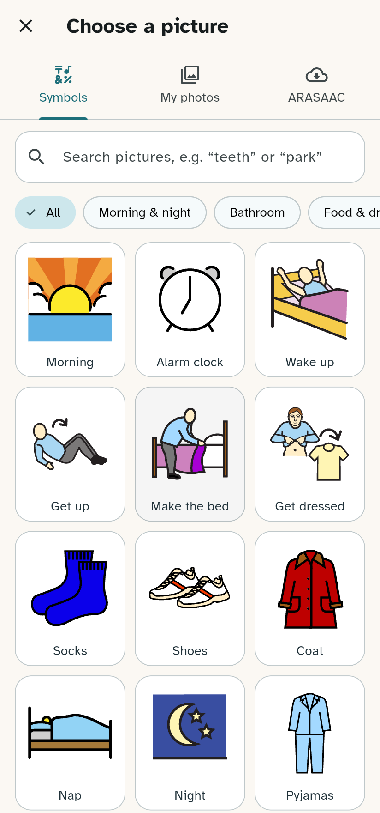</td>
  </tr>
</table>

- **Schedules** (any number of steps) and **first–then boards**.
- **Drag to reorder** steps. On tablets and computers, **drag pictures straight
  from the library** onto the board, or between two steps.
- **179 bundled pictograms** from Mulberry Symbols and OpenMoji, searchable and
  grouped (morning & night, bathroom, food, school, play, places, people,
  feelings, now & next).
- **The family's own photos** sit next to the pictograms: take one with the
  camera or pick one from the gallery (*Grandma's house*, *our car*).
- **Optional ARASAAC**: search the large ARASAAC catalogue online and keep the
  pictograms you choose on the device ([why it's optional](#pictures-and-licences)).
- Four ready-made example boards, undo after deleting, duplicate, rename.

### Sharing between devices

<table>
  <tr>
    <td width="66%">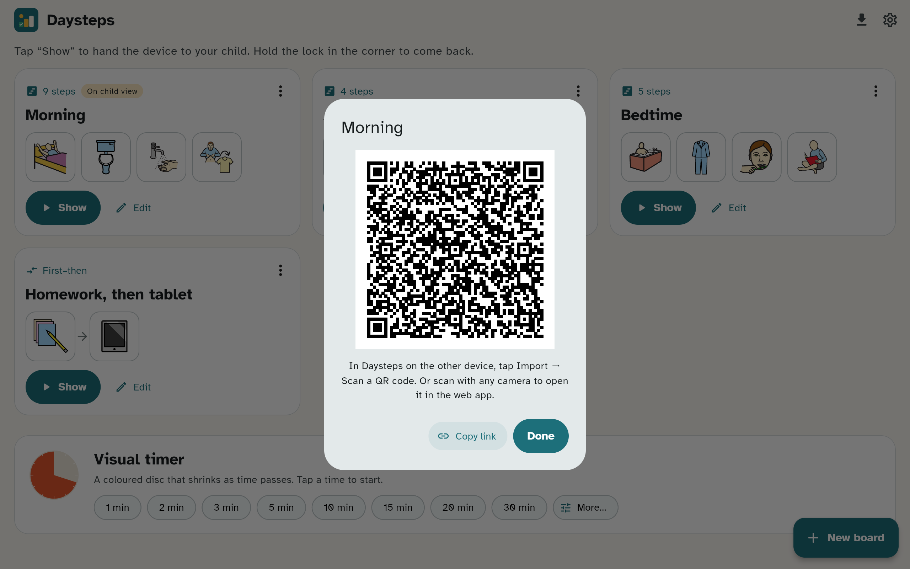</td>
    <td width="34%">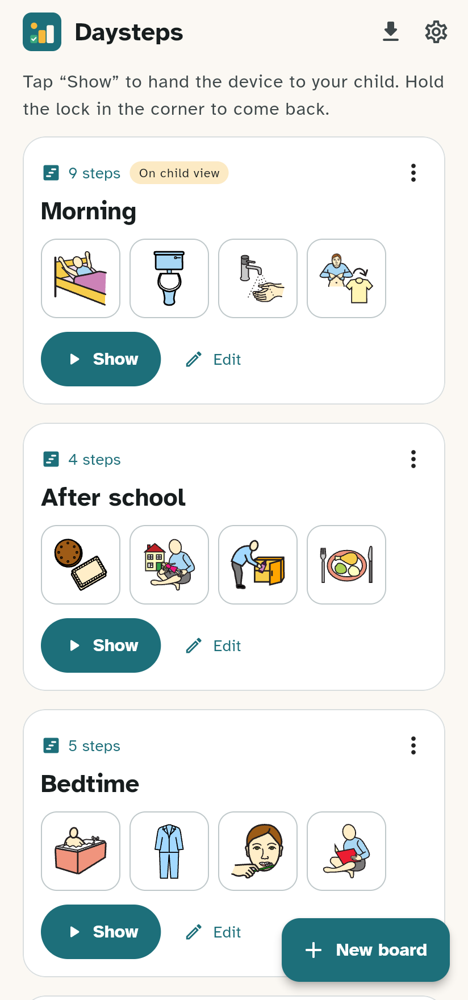</td>
  </tr>
</table>

- **QR code**: show it on your phone, scan it with Daysteps on the child's
  tablet (*Import → Scan a QR code*). The code is also a link, so any phone
  camera opens the board in the web app.
- **`.daysteps` file**: send it by email, chat or Drive; it carries photos
  too.
- **Back up and restore** every board and photo in one file.

## Get Daysteps

### Android (7.0 and newer)

1. Open the [latest release][latest] and download
   **`daysteps-<version>-android-arm64-v8a.apk`**, which suits most phones and
   tablets. For older 32-bit devices pick `armeabi-v7a`; if you're not sure,
   `daysteps-<version>-android.apk` works on every device but is larger.
2. Open the file and allow installing from your browser or file manager when
   Android asks.
3. Optional, for a child's tablet: in Daysteps turn on **Settings → Open
   straight to the child view**, and use Android's
   [app pinning](https://support.google.com/android/answer/9455138) to keep
   the child inside the app.

### Web (any modern browser)

Open **<https://lobojoel2003.github.io/Daysteps/>**. After the first visit it
works offline, and you can install it from the browser menu (*Install app* /
*Add to Home screen*). Your boards are stored in that browser only.

To host it yourself, unzip `daysteps-<version>-web.zip` from a release onto any
static web server.

## Quick start

1. **Pick or make a board.** The example *Morning* board is ready to go. Tap
   **New board** for your own schedule or first–then board.
2. **Add steps.** Tap **Add step**, choose a picture, adjust the words, and add
   a timer if you like. Drag the handles to change the order.
3. **Tap Show** and hand over the device. Your child taps **Done** after each
   step.
4. **To come back**, press and hold the lock in the top corner for two seconds
   and answer the sum.
5. **To put the board on your child's own device**, tap **Share → Show a QR
   code** and scan it from the other device (*Import → Scan a QR code*).

## Pictures and licences

| Set | In Daysteps | Licence |
|---|---|---|
| [Mulberry Symbols](https://mulberrysymbols.org) by Steve Lee | 136 symbols, bundled | [CC BY-SA 4.0](https://creativecommons.org/licenses/by-sa/4.0/) |
| [OpenMoji](https://openmoji.org) by HfG Schwäbisch Gmünd and contributors | 43 symbols, bundled | [CC BY-SA 4.0](https://creativecommons.org/licenses/by-sa/4.0/) |
| [ARASAAC](https://arasaac.org) by Sergio Palao, Government of Aragón | **optional download**, never bundled | [CC BY-NC-SA 4.0](https://creativecommons.org/licenses/by-nc-sa/4.0/) |

ARASAAC is the largest free pictogram set, but its *non-commercial* licence
would stop anyone from redistributing Daysteps commercially, so it is not part
of the app. An adult can search it from the picture library and download
individual pictograms, which are then stored on the device with their
attribution.

The bundled SVGs were optimised for the app; see
[`assets/symbols/ATTRIBUTION.md`](assets/symbols/ATTRIBUTION.md) for details,
and `tool/symbols/` to rebuild them from the original sources. The interface
font is [Atkinson Hyperlegible](https://www.brailleinstitute.org/freefont/) by
the Braille Institute (SIL Open Font License 1.1), designed for readers with low
vision.

## Privacy

No account, no ads, no analytics. Boards, settings and photos stay on the
device. The internet is used only if you choose to search ARASAAC. See
[PRIVACY.md](PRIVACY.md).

## Build from source

You need **Flutter 3.50** (stable). For Android builds, the Android SDK and
JDK 17 or newer; for host tests on Linux, `libsqlite3-dev`.

```bash
git clone https://github.com/lobojoel2003/Daysteps.git
cd Daysteps
flutter pub get
```

Run it:

```bash
flutter run -d chrome
```

```bash
flutter run -d <your-android-device>
```

Check and test (CI runs exactly this):

```bash
dart format --output=none --set-exit-if-changed lib test
flutter analyze --fatal-infos
flutter test
```

Release builds:

```bash
flutter build apk --release --split-per-abi
```

```bash
flutter build web --release --no-web-resources-cdn --web-content-hash --base-href /Daysteps/
python3 tool/web/finalize_build.py build/web
```

<details>
<summary><b>How it's built</b></summary>

| Concern | Choice |
|---|---|
| UI | Flutter (`material_ui`), Atkinson Hyperlegible font |
| State | Riverpod 3 |
| Storage | [drift](https://drift.simonbinder.eu) (SQLite): a file on Android, WASM SQLite in the browser (OPFS / IndexedDB). Photos are stored as blobs, so both platforms share one code path. |
| Pictograms | Optimised SVGs rendered with `flutter_svg` |
| Speech | `flutter_tts` (Android TextToSpeech / Web Speech API) |
| Sharing | JSON `.daysteps` files; QR codes carry zlib-compressed, base64url JSON inside a web-app link |
| Offline web | A small service worker (`web/sw.js`) that precaches the content-hashed build |

```
lib/
  main.dart                 start-up: open the database, seed examples, run the app
  src/data/                 drift tables, repository, models, example boards
  src/share/                .daysteps files, QR codes and links, import/export
  src/services/             text-to-speech, optional ARASAAC client
  src/symbols/              bundled pictogram catalogue and search
  src/ui/child/             the child's view: schedule, first–then, timer, adult lock
  src/ui/adult/             home, editor, picture library, sharing, settings, about
  src/ui/widgets/           picture renderer, visual timer, done animation, QR code
assets/symbols/             179 SVG pictograms + catalog.json
tool/                       version bump, pictogram, icon, web and screenshot scripts
test/                       unit and widget tests
```

Regenerate the database code after changing tables:
`dart run build_runner build --delete-conflicting-outputs`. Refresh the
README screenshots with `node tool/screenshots/capture.mjs` (after a web
build).
</details>

## Releases and versioning

Daysteps follows [Semantic Versioning](https://semver.org). The version lives
in one place, `pubspec.yaml`:

```yaml
version: 1.0.0+1   # MAJOR.MINOR.PATCH+BUILD
```

- **`1.0.0`** is the version name people see, and the git tag is `v1.0.0`.
- **`+1`** is the build number: Android's `versionCode`. It goes up by one with
  every release, so Android always accepts an update.
- Every release has a section in [CHANGELOG.md](CHANGELOG.md).

To cut a release:

```bash
dart run tool/bump_version.dart minor
```

This bumps `pubspec.yaml` (for example `1.0.0+1 → 1.1.0+2`) and moves the
`[Unreleased]` notes in the changelog under the new version. Then commit, tag
and push:

```bash
git commit -am "Release v1.1.0"
```

```bash
git tag -a v1.1.0 -m "Daysteps 1.1.0"
```

```bash
git push origin main --follow-tags
```

Prefer not to push tags? After pushing the version bump, open **Actions →
Release → Run workflow** on `main`: it releases the version in `pubspec.yaml`
and creates the `vX.Y.Z` tag on that commit.

Either way the **Release** workflow checks that the tag matches
`pubspec.yaml`, runs the tests, builds the APKs, App Bundle and web app,
publishes a GitHub Release with checksums and the changelog notes, and deploys
the web app. Tags with a suffix such as `v1.2.0-beta.1` become pre-releases.

<details>
<summary><b>Signing Android releases</b></summary>

Without signing secrets the Release workflow signs APKs with a temporary debug
key, which is fine for trying the app. For releases people can update in place
(and for Google Play), create an upload key once:

```bash
keytool -genkey -v -keystore daysteps-release.jks -keyalg RSA -keysize 4096 -validity 10000 -alias daysteps
```

Then add four repository secrets under **Settings → Secrets and variables →
Actions**:

| Secret | Value |
|---|---|
| `ANDROID_KEYSTORE_BASE64` | output of `base64 -w0 daysteps-release.jks` |
| `ANDROID_KEYSTORE_PASSWORD` | the keystore password |
| `ANDROID_KEY_ALIAS` | `daysteps` |
| `ANDROID_KEY_PASSWORD` | the key password |

Keep the `.jks` file and passwords safe: every future update must be signed
with the same key. For local release builds, create `android/key.properties`
with `storeFile`, `storePassword`, `keyAlias` and `keyPassword` (it is
git-ignored).
</details>

## CI/CD

| Workflow | Runs on | What it does |
|---|---|---|
| [CI](.github/workflows/ci.yml) | every push and every pull request | format check, generated-code check, `flutter analyze --fatal-infos`, tests with coverage, then builds an Android APK and the web app as downloadable artifacts |
| [Release](.github/workflows/release.yml) | tags `v*.*.*`, or *Run workflow* on `main` | version check, tests, universal and per-ABI APKs, App Bundle (when signed), web zip, `SHA256SUMS.txt`, GitHub Release with notes from the changelog, web app deployed to the `gh-pages` branch |
| [Dependabot](.github/dependabot.yml) | weekly / monthly | keeps Flutter packages and GitHub Actions up to date |

The web app is served by GitHub Pages from the `gh-pages` branch (**Settings →
Pages → Deploy from a branch → `gh-pages` / root**).

## Contributing

Ideas, bug reports and pull requests are welcome, especially from parents,
teachers and therapists. Please read [CONTRIBUTING.md](CONTRIBUTING.md) first;
the short version is *keep the child's screen simple and calm*. Security issues:
see [SECURITY.md](SECURITY.md).

## License

Daysteps is free software under the [GNU General Public License v3.0](LICENSE).
Bundled pictograms are CC BY-SA 4.0 (see [Pictures and licences](#pictures-and-licences)),
and the font is under the SIL Open Font License 1.1.

[asat]: https://www.asatonline.org/for-parents/activity-schedules/
[knight]: https://doi.org/10.1007/s10803-014-2201-z
[cdc]: https://www.cdc.gov/mmwr/volumes/74/ss/ss7402a1.htm
[choiceworks]: https://apps.apple.com/us/app/choiceworks/id486210964
[pictoplan]: https://apps.apple.com/me/app/pictoplan/id733542401
[pictalk]: https://apps.apple.com/us/app/id6502835578
[latest]: https://github.com/lobojoel2003/Daysteps/releases/latest
